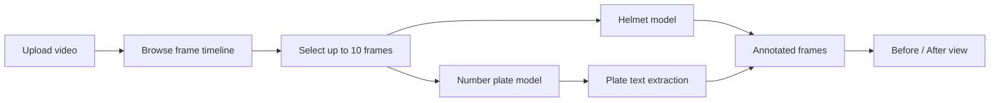

<div align="center">

# Traffic Vision

**Road footage, made legible.**
Upload a traffic video, pick the frames that matter, and let two YOLO models detect helmets and extract number plates, with a before/after view of every result.

[](https://trafficvision-0.streamlit.app/)


<sub>20-second walkthrough · <a href="assets/demo.mp4">Watch the full-quality video</a> · The footage in the demo is an illustrative sample.</sub>

</div>

---

## Overview

Traffic Vision is a computer vision application for analysing road footage. Running detection on every frame of a video is slow and wasteful, so Traffic Vision uses an **Optimized Processing Mode**: you scrub through the clip, select up to 10 frames, and detection runs only on those. The result is a quick path from raw clip to useful insight.

**Try it live:** [trafficvision-0.streamlit.app](https://trafficvision-0.streamlit.app/)

For each selected frame the app:

1. **Detects helmets** using a custom helmet classification model.
2. **Detects number plates** using a custom number plate detection model, then reads the plate text.
3. **Shows a Before / After comparison** with labelled bounding boxes drawn on the frame.

## Features

- **Video upload**: drop in an MP4 clip from your device.
- **Frame selection**: browse a thumbnail timeline, step through frames with *Prev / Next* and *±10 frames* controls, and grab up to 10 frames to analyse.
- **Optimized Processing Mode**: detection runs only on the selected frames, which keeps analysis fast.
- **Helmet detection**: flags riders with and without helmets.
- **Number plate extraction**: locates plates and extracts their text.
- **Before / After view**: compare the original frame with the annotated one, side by side.

## How it works



## Tech stack

| Layer | Tools |
|---|---|
| UI | Streamlit |
| Object detection | Ultralytics YOLO (`Helmet_Classification_Model.pt`, `NumberPlate_Detection_Model.pt`) |
| Plate text extraction | PaddleOCR via PaddleX / PaddlePaddle |
| Video and image processing | OpenCV, imageio-ffmpeg |
| Text rendering | python-bidi |
| Serving | Flask, gunicorn |

## Getting started

### Prerequisites

- Python 3.10+
- System packages listed in `packages.txt` (for example, on Debian/Ubuntu: `sudo xargs apt-get install -y < packages.txt`)

### Installation

```bash
git clone https://github.com/Ahmed0469/Traffic_Vision.git
cd Traffic_Vision

python -m venv .venv
source .venv/bin/activate        # Windows: .venv\Scripts\activate

pip install -r requirements.txt
```

### Run

```bash
streamlit run streamlit_app.py
```

Open the local URL Streamlit prints (usually `http://localhost:8501`), upload a video, select your frames, and click **Analyze selected frames**.

## Project structure

```
Traffic_Vision/
├── src/                                # Application source code
├── streamlit_app.py                    # Streamlit entry point
├── Helmet_Classification_Model.pt      # Helmet detection model weights
├── NumberPlate_Detection_Model.pt      # Number plate detection model weights
├── requirements.txt                    # Python dependencies
├── packages.txt                        # System-level dependencies
├── keep_alive.py                       # Keeps the hosted demo awake
├── .streamlit/                         # Streamlit configuration
├── .devcontainer/                      # Dev container setup
├── .github/workflows/                  # GitHub Actions automation
└── assets/                             # README media (demo GIF and video)
```

## Roadmap

- [ ] Batch mode for analysing full videos
- [ ] Export detections as CSV or JSON
- [ ] Per-detection confidence scores in the UI
- [ ] Support for additional violation types

## Author

**Ahmed**: AI Engineer · Karachi, Pakistan
[Portfolio](https://ahmed0469.github.io/) · [GitHub](https://github.com/Ahmed0469) · [LinkedIn](https://www.linkedin.com/in/your-handle)

---

<div align="center"><sub>If you found this useful, consider giving the repo a ⭐</sub></div>
